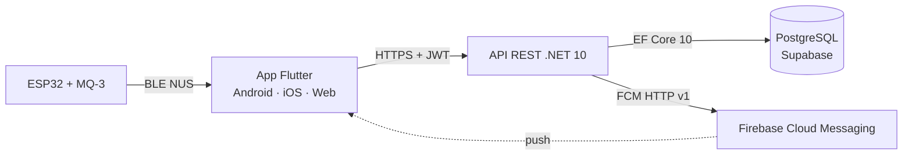
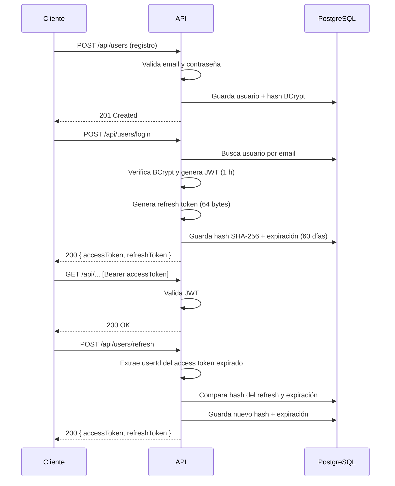

# 🍺 Alcoholímetro IoT — API REST

[README raíz](../README.md) · [App Flutter](../APP/README.md) · [Runbook](../RUNBOOK.md)

API REST central del sistema. La **app Flutter** (Android, iOS y web) es el
cliente que la consume; el **ESP32 no se conecta a Internet**: actúa como
periférico BLE y es la app móvil la que hace de puente hacia la API.

La API gestiona autenticación JWT con refresh tokens, usuarios, mediciones
geolocalizadas, cálculo orientativo del semáforo, grupos colaborativos con
ranking y notificaciones push mediante Firebase Cloud Messaging (FCM).

> **Proyecto educativo (TFG).** No es un alcoholímetro homologado ni un
> producto comercial. Las mediciones son orientativas y no sustituyen a un test
> oficial, a una valoración médica ni al criterio de las autoridades.

---

## Índice

- [Responsabilidades](#responsabilidades)
- [Arquitectura](#arquitectura)
- [Stack tecnológico](#stack-tecnológico)
- [Seguridad](#seguridad)
- [Puesta en marcha](#puesta-en-marcha)
- [Configuración](#configuración)
- [Base de datos y migraciones](#base-de-datos-y-migraciones)
- [Endpoints](#endpoints)
- [Modelos de datos](#modelos-de-datos)
- [Flujo de autenticación](#flujo-de-autenticación)
- [Códigos HTTP y errores](#códigos-http-y-errores)
- [Tests](#tests)
- [Despliegue](#despliegue)
- [Limitaciones conocidas](#limitaciones-conocidas)
- [Documentación relacionada](#documentación-relacionada)

---

## Responsabilidades

| Área | Qué resuelve la API |
|---|---|
| **Autenticación** | Registro, login, refresh tokens rotativos y perfil del usuario. |
| **Mediciones** | Guarda la lectura en mg/L con timestamp UTC y coordenadas; calcula el semáforo y el tiempo estimado hasta verde. |
| **Grupos** | Creación, unión por código, roles, miembros, configuración de umbral, ranking y abandono/expulsión. |
| **Alertas** | Envía push FCM cuando una medición alcanza el umbral de un grupo. |
| **Persistencia** | EF Core 10 sobre PostgreSQL (Supabase u otro PostgreSQL). |
| **Documentación** | OpenAPI + Swagger UI en Development. |

---

## Arquitectura

Clean Architecture con CQRS y Domain-Driven Design, dividida en cuatro capas:



| Capa | Responsabilidad |
|---|---|
| `Alcoholimetro.Domain` | Entidades (`User`, `Measurement`, `Group`, `UserGroup`), value objects (`Email`, `Latitude`, `Longitude`, `Coordinates`), enums, excepciones y cálculo de alcoholemia. Sin dependencias externas. |
| `Alcoholimetro.Application` | Commands, queries, handlers, DTOs, interfaces (`IJwtProvider`, `IPushNotificationService`) y hash de contraseñas con BCrypt. |
| `Alcoholimetro.Infrastructure` | EF Core + Npgsql, repositorios, migraciones, `JwtProvider` y servicios de notificación FCM/mock. |
| `Alcoholimetro.Api` | Controladores, inyección de dependencias, middleware de excepciones, autenticación JWT, CORS y Swagger/OpenAPI. |

La API **no habla con el ESP32**: recibe las mediciones que la app envía después
de leer el sensor por BLE.

---

## Stack tecnológico

| Componente | Tecnología | Versión |
|---|---|---|
| Framework | .NET / ASP.NET Core | 10.0 (`net10.0`) |
| ORM | Entity Framework Core | 10.0.3 |
| Base de datos | PostgreSQL (Supabase) | — |
| Provider DB | Npgsql.EntityFrameworkCore.PostgreSQL | 10.0.0 |
| Autenticación | Microsoft.AspNetCore.Authentication.JwtBearer | 10.0.4 |
| Hash de contraseñas | BCrypt.Net-Next | 4.1.0 |
| OpenAPI | Microsoft.AspNetCore.OpenApi | 10.0.4 |
| Modelo OpenAPI | Microsoft.OpenApi | 2.3.9 |
| Swagger UI | Swashbuckle.AspNetCore.SwaggerUI | 10.1.5 |
| Tokens JWT | System.IdentityModel.Tokens.Jwt | 8.16.0 |
| FCM | Google.Apis.Auth (OAuth 2.0) | 1.68.0 |
| Tests | xUnit + Moq + FluentAssertions | 2.9.3 / 4.20.72 / 8.9.0 |

---

## Seguridad

| Aspecto | Implementación |
|---|---|
| **Contraseñas** | Hash unidireccional con **BCrypt** (salting + hashing). Nunca se guardan en texto plano. |
| **Política de contraseña** | Mínimo 8 caracteres, al menos una letra y un dígito. |
| **Access token** | JWT firmado con **HMAC-SHA256**, expiración de **1 hora**. Claims: `sub` (userId), `email`, `isNovice`. |
| **Refresh token** | 64 bytes aleatorios en Base64, guardados como hash **SHA-256** en la BD. Expiración de **60 días** y rotación en cada refresco. |
| **Sesión** | Un único refresh token activo por usuario; un login nuevo invalida el anterior. El logout es local en el cliente (no hay endpoint de revocación). |
| **Endpoints protegidos** | Todos los controladores llevan `[Authorize]`; solo registro, login y refresh son públicos. |
| **Identidad** | El `userId` de una medición se extrae del JWT (`NameIdentifier`), no del body. |
| **Historial** | `GET /api/measurements/user/{userId}` solo permite consultar el historial propio; otro usuario recibe `403`. |
| **Grupos** | Las consultas y acciones comprueban pertenencia; expulsar, ascender y cambiar el umbral requieren rol `Admin`. |
| **Secretos** | User Secrets en desarrollo y variables de entorno/secretos en producción. Nunca se suben credenciales ni cuentas de servicio. |
| **Red** | HTTPS, HSTS en producción y cabeceras `X-Content-Type-Options`, `X-Frame-Options` y `Referrer-Policy`. |
| **CORS** | Orígenes configurables en `Cors:AllowedOrigins`. En Development, una lista vacía activa un fallback permisivo solo para desarrollo. |

### Limitaciones de seguridad actuales

- No hay verificación de email, recuperación de contraseña, rate limiting ni
  bloqueo por intentos fallidos.
- No existe un rol global de administrador: `GET /api/users`,
  `GET /api/users/{id}` y `DELETE /api/users/{id}` están disponibles para
  cualquier usuario autenticado. Es una mejora pendiente.
- El logout no revoca el refresh token en el servidor.
- El middleware activo no mapea `NotFoundException` ni `ConflictException`
  (ver [Códigos HTTP y errores](#códigos-http-y-errores)).

---

## Puesta en marcha

### Requisitos

- [.NET 10 SDK](https://dotnet.microsoft.com/download).
- Herramienta de EF Core: `dotnet tool install --global dotnet-ef`.
- PostgreSQL local o un proyecto de [Supabase](https://supabase.com/).
- Opcional: Docker para construir la imagen; `ngrok` para exponer la API local.

### 1. Clonar y restaurar

```bash
git clone https://github.com/carguegar/Alcoholometer.git
cd Alcoholometer
dotnet restore API/Alcoholimetro.slnx
```

### 2. Configurar secretos locales

`appsettings.json` contiene valores vacíos o de ejemplo. Los secretos reales se
gestionan con **User Secrets** (el proyecto ya tiene `UserSecretsId`) o con
variables de entorno:

```bash
dotnet user-secrets set "ConnectionStrings:DefaultConnection" "Host=localhost;Port=5432;Database=alcoholimetro;Username=postgres;Password=TU_PASSWORD" --project API/Alcoholimetro.Api

dotnet user-secrets set "Jwt:Secret" "TU_CLAVE_DE_AL_MENOS_32_CARACTERES" --project API/Alcoholimetro.Api
```

> **Supabase:** si usas el Transaction Pooler, emplea el puerto **6543** y añade
> `No Reset On Close=true` para evitar que PgBouncer corte conexiones asíncronas
> de .NET. Revisa también `Max Auto Prepare=0` y `Pooling=false` si aparecen
> errores de conexión.

### 3. Arrancar la API

```bash
dotnet run --project API/Alcoholimetro.Api/Alcoholimetro.Api.csproj
```

| Perfil | URL |
|---|---|
| HTTP | `http://localhost:5231` |
| HTTPS | `https://localhost:7287` |
| Swagger UI | `http://localhost:5231/swagger` (solo Development) |
| OpenAPI JSON | `http://localhost:5231/openapi/v1.json` (solo Development) |

La API **no aplica migraciones automáticamente** al arrancar. Si la base de datos
está vacía, aplica los scripts o las migraciones antes de usar los endpoints.

### 4. Exponer la API para la app móvil (opcional)

El ESP32 no necesita acceder a la API. Para probar la app en un móvil físico
contra tu máquina local:

```bash
ngrok http 5231
```

Copia la URL HTTPS de ngrok y pásala a la app con
`--dart-define=API_BASE_URL=https://...`. Añade ese origen a
`Cors:AllowedOrigins` si vas a usar la versión web.

---

## Configuración

| Clave | Obligatoria | Valor por defecto | Notas |
|---|---|---|---|
| `ConnectionStrings:DefaultConnection` | Sí | vacío | Sin una cadena válida, las operaciones de base de datos fallan. |
| `Jwt:Issuer` | No | `AlcoholimetroApi` | Debe coincidir al validar el token. |
| `Jwt:Audience` | No | `AlcoholimetroApp` | Debe coincidir al validar el token. |
| `Jwt:ExpirationInHours` | No | `1` | Duración del access token. |
| `Jwt:Secret` | Sí | — | Clave HMAC-SHA256 de al menos 32 caracteres. |
| `Cors:AllowedOrigins` | No | `["https://formidable-rune-490709-m6.web.app"]` | Array de orígenes exactos. |
| `Firebase:ProjectId` | No | `alcoholimetro-1f6ab` | Debe coincidir con el proyecto de Firebase. |
| `Firebase:CredentialsPath` | No | `firebase-credentials.json` | Ruta al JSON de la cuenta de servicio. |
| `GOOGLE_APPLICATION_CREDENTIALS` | No | — | Alternativa a `Firebase:CredentialsPath`. |

### CORS

`Program.cs` registra la política `DefaultCorsPolicy` a partir de
`Cors:AllowedOrigins`:

- En **Development**, si el array está vacío, se permite cualquier origen
  (`AllowAnyOrigin`) como fallback de desarrollo.
- En **cualquier otro entorno**, un array vacío no permite ningún origen.
- `WithOrigins("*")` **no** equivale a permitir todos los orígenes. El
  `appsettings.Development.json` del repositorio trae `"*"`; para evitar
  ambigüedades, usa una lista explícita de orígenes o déjala vacía para activar
  el fallback de Development.

Ejemplo:

```json
"Cors": {
  "AllowedOrigins": [
    "http://localhost:62443",
    "https://formidable-rune-490709-m6.web.app",
    "https://abcd.ngrok-free.app"
  ]
}
```

### Firebase / FCM

La API elige el servicio de notificaciones al arrancar:

| Condición | Servicio |
|---|---|
| `Firebase:CredentialsPath` o `GOOGLE_APPLICATION_CREDENTIALS` tienen valor | `FcmHttpV1PushNotificationService` (FCM real). |
| Ambos vacíos y entorno **Development** | `MockPushNotificationService` (solo logs). |
| Ambos vacíos y entorno distinto de Development | FCM real; si no hay credenciales válidas, no envía y registra un aviso. |

> `appsettings.json` trae `"CredentialsPath": "firebase-credentials.json"`, así
> que el mock **no se activa automáticamente**. Para usarlo en local, deja
> `Firebase:CredentialsPath` vacío y no definas `GOOGLE_APPLICATION_CREDENTIALS`.
> Si la ruta existe pero el archivo no, el servicio real registra un warning y
> desactiva los envíos; no cae al mock.

El token del dispositivo se registra con `PUT /api/users/device-token` y se
guarda en `User.DevicePushToken`. Cuando una medición alcanza el umbral de un
grupo, la API envía una notificación a los demás miembros (con la ubicación en
el cuerpo) y otra al propio usuario.

El `Firebase:ProjectId` de la API y el proyecto configurado en la app Flutter
deben ser el mismo. Si `APP/lib/firebase_options.dart` o
`APP/web/firebase-messaging-sw.js` apuntan a otro proyecto, regénéralos con
`flutterfire configure` y actualiza el service worker.

---

## Base de datos y migraciones

EF Core usa PostgreSQL. Las migraciones incluidas cubren la licencia de conducir,
el sistema de grupos y los refresh tokens.

Debido al Connection Pooler de Supabase, `dotnet ef database update` puede fallar
con errores de `ManualResetEventSlim disposed`. El flujo recomendado es generar
un script SQL idempotente y ejecutarlo en el **SQL Editor** de Supabase:

```bash
# 1. Crear la migración
dotnet ef migrations add NombreDescriptivo \
  --project API/Alcoholimetro.Infrastructure \
  --startup-project API/Alcoholimetro.Api

# 2. Generar el script idempotente
dotnet ef migrations script \
  --project API/Alcoholimetro.Infrastructure \
  --startup-project API/Alcoholimetro.Api \
  --idempotent -o nombre_script.sql
```

Después copia el contenido del `.sql` en Supabase. El repositorio incluye
scripts ya generados:

| Script | Contenido |
|---|---|
| `API/actualizacion.sql` | Esquema base y actualizaciones iniciales. |
| `API/grupos.sql` | Tablas y relaciones del sistema de grupos. |
| `API/refresh.sql` | Columnas de refresh tokens. |

---

## Endpoints

Todos los endpoints están bajo el prefijo `/api`. Los marcados con 🔐 requieren
`Authorization: Bearer <token>`.

Convenciones:

- Fechas y timestamps en ISO 8601 (`2026-03-26T14:30:00Z`).
- `birthDate` y `drivingLicenseIssueDate` usan `YYYY-MM-DD`.
- Los roles de grupo se serializan como `"Admin"` o `"Member"`.
- El color del semáforo se serializa como número: `0` verde, `1` amarillo,
  `2` rojo.
- Los errores de dominio capturados por el middleware devuelven `ProblemDetails` (`application/problem+json`); algunas validaciones del controlador devuelven `{ "error": "..." }`.

### Usuarios — `/api/users`

| Método | Ruta | Auth | Descripción |
|---|---|---|---|
| `POST` | `/api/users` | Público | Registrar usuario. |
| `POST` | `/api/users/login` | Público | Iniciar sesión y obtener tokens. |
| `POST` | `/api/users/refresh` | Público | Rotar access + refresh token. |
| `GET` | `/api/users` | 🔐 | Listar todos los usuarios. |
| `GET` | `/api/users/me` | 🔐 | Perfil del usuario autenticado. |
| `GET` | `/api/users/{id}` | 🔐 | Obtener un usuario por ID. |
| `PUT` | `/api/users/{id}` | 🔐 | Actualizar peso, altura y licencia. |
| `PUT` | `/api/users/device-token` | 🔐 | Registrar/actualizar el token FCM. |
| `DELETE` | `/api/users/{id}` | 🔐 | Eliminar un usuario. |

#### Registro — `POST /api/users`

```json
{
  "firstName": "Carlos",
  "lastName": "García",
  "secondLastName": "López",
  "emailRaw": "carlos@ejemplo.com",
  "password": "MiContraseña123",
  "birthDate": "1998-05-15",
  "weightKg": 75.5,
  "heightCm": 178.0,
  "biologicalSex": "Male",
  "drivingLicenseIssueDate": "2024-03-01"
}
```

`drivingLicenseIssueDate` es opcional (`null` si no tiene licencia). La
contraseña debe tener al menos 8 caracteres, una letra y un dígito.

**Respuesta:** `201 Created`

```json
{
  "id": "3fa85f64-5717-4562-b3fc-2c963f66afa6",
  "message": "Usuario creado con éxito."
}
```

La cabecera `Location` apunta a `/api/users/{id}`.

#### Login — `POST /api/users/login`

`LoginCommand` recibe un **value object `Email`**, no un string. El body debe
enviar el email anidado:

```json
{
  "emailRaw": {
    "value": "carlos@ejemplo.com"
  },
  "password": "MiContraseña123"
}
```

> **Ojo:** el registro usa `"emailRaw": "carlos@ejemplo.com"` (string), pero el
> login usa `"emailRaw": { "value": "carlos@ejemplo.com" }` (objeto). Es una
> asimetría heredada del modelo de dominio.

**Respuesta:** `200 OK`

```json
{
  "accessToken": "eyJhbGciOiJIUzI1NiIs...",
  "refreshToken": "base64string..."
}
```

Credenciales incorrectas devuelven `400 Bad Request` con
`"detail": "Credenciales incorrectas."`.

#### Refresh — `POST /api/users/refresh`

```json
{
  "accessToken": "eyJhbGciOiJIUzI1NiIs...",
  "refreshToken": "base64string..."
}
```

**Respuesta:** `200 OK` con un nuevo `accessToken` y un nuevo `refreshToken`.
El refresh anterior queda invalidado (rotación). Si el refresh no coincide con
el hash almacenado o ha expirado, devuelve `400`.

#### Perfil — `GET /api/users/me` y `GET /api/users/{id}`

**Respuesta:** `200 OK`

```json
{
  "id": "3fa85f64-5717-4562-b3fc-2c963f66afa6",
  "fullName": "Carlos García López",
  "email": "carlos@ejemplo.com",
  "age": 27,
  "weightKg": 75.5,
  "heightCm": 178.0,
  "biologicalSex": "Male",
  "isNoviceDriver": true,
  "hasLicense": true
}
```

`isNoviceDriver` es `true` si la licencia se emitió hace menos de dos años.

#### Actualizar usuario — `PUT /api/users/{id}`

```json
{
  "userId": "3fa85f64-5717-4562-b3fc-2c963f66afa6",
  "weightKg": 80.0,
  "heightCm": 178.0,
  "hasLicense": true
}
```

El `userId` del body debe coincidir con el `{id}` de la ruta; si no, devuelve
`400`. `hasLicense` es opcional: si se envía `true` y no había fecha de licencia,
se guarda la fecha actual; si se envía `false`, se borra.

**Respuesta:** `200 OK`

```json
{ "message": "Usuario actualizado con éxito." }
```

#### Registrar token FCM — `PUT /api/users/device-token`

```json
{
  "deviceToken": "fcm-token-del-dispositivo..."
}
```

**Respuesta:** `200 OK`. El token se valida como no vacío y de máximo 4096
caracteres.

#### Eliminar usuario — `DELETE /api/users/{id}`

**Respuesta:** `204 No Content`.

---

### Mediciones — `/api/measurements`

| Método | Ruta | Auth | Descripción |
|---|---|---|---|
| `POST` | `/api/measurements` | 🔐 | Registrar medición y calcular semáforo. |
| `GET` | `/api/measurements/user/{userId}` | 🔐 | Historial paginado del usuario. |

#### Registrar medición — `POST /api/measurements`

```json
{
  "measurementLevel": 0.25,
  "lat": 40.4168,
  "lng": -3.7038
}
```

El `userId` se extrae del JWT (`sub` / `NameIdentifier`) y **no** se envía en el
body. La medición se guarda con timestamp UTC y coordenadas validadas
(latitud −90..90, longitud −180..180).

**Respuesta:** `201 Created`

```json
{
  "color": 1,
  "message": "Tasa ilegal. Darías positivo. Espera al menos 1h y 30m. (Estimación personalizada)",
  "estimatedTimeToGreen": "01:30:00"
}
```

| Campo | Tipo | Notas |
|---|---|---|
| `color` | `0 \| 1 \| 2` | `0` verde, `1` amarillo, `2` rojo. |
| `message` | string | Mensaje para mostrar al usuario. |
| `estimatedTimeToGreen` | string \| null | `TimeSpan` serializado como `hh:mm:ss`; `null` en verde. |

Límites de referencia usados por el cálculo:

| Perfil | Límite legal | Color |
|---|---|---|
| General | 0,25 mg/L | Verde si `<= 0,25`. |
| Conductor novel | 0,15 mg/L | Verde si `<= 0,15`. |
| Tasa delictiva | 0,60 mg/L | Rojo si `>= 0,60`. |
| Resto | — | Amarillo. |

El tiempo estimado usa una tasa de eliminación simplificada (0,075 mg/L/h por
defecto, 0,085 para `Female`/`F`/`Femenino`, ajustada por peso y limitada a
0,05–0,10). Es una aproximación, no un modelo farmacocinético.

#### Historial — `GET /api/measurements/user/{userId}`

| Query | Tipo | Default | Descripción |
|---|---|---|---|
| `page` | int | `1` | Página solicitada. |
| `pageSize` | int | `20` | Elementos por página. |

Solo se puede consultar el historial propio; otro `userId` devuelve `403`.
La respuesta es un array ordenado por fecha descendente (no incluye total de
páginas):

```json
[
  {
    "id": "3fa85f64-5717-4562-b3fc-2c963f66afa6",
    "userId": "3fa85f64-5717-4562-b3fc-2c963f66afa6",
    "alcoholLevel": 0.35,
    "timestamp": "2026-03-26T14:30:00Z",
    "latitude": 40.4168,
    "longitude": -3.7038
  }
]
```

---

### Grupos — `/api/groups`

| Método | Ruta | Auth | Descripción |
|---|---|---|---|
| `POST` | `/api/groups` | 🔐 | Crear grupo; el creador es `Admin`. |
| `POST` | `/api/groups/join` | 🔐 | Unirse con código de invitación. |
| `GET` | `/api/groups` | 🔐 | Listar los grupos del usuario. |
| `GET` | `/api/groups/{groupId}` | 🔐 | Detalles y miembros (solo miembros). |
| `GET` | `/api/groups/{groupId}/ranking` | 🔐 | Ranking del grupo (solo miembros). |
| `DELETE` | `/api/groups/{groupId}/leave` | 🔐 | Abandonar el grupo. |
| `DELETE` | `/api/groups/{groupId}/members/{targetUserId}` | 🔐 | Expulsar miembro (`Admin`). |
| `PUT` | `/api/groups/{groupId}/members/{targetUserId}/admin` | 🔐 | Ascender a `Admin` (`Admin`). |
| `PUT` | `/api/groups/{groupId}/config` | 🔐 | Cambiar umbral de alerta (`Admin`). |

#### Crear grupo — `POST /api/groups`

```json
{
  "name": "Amigos del viernes",
  "description": "Grupo para controlar el consumo en las salidas"
}
```

**Respuesta:** `201 Created`

```json
{
  "message": "Grupo creado con éxito.",
  "groupId": "3fa85f64-5717-4562-b3fc-2c963f66afa6",
  "invitationCode": "A1B2C3"
}
```

El código es alfanumérico, de 6 caracteres y se genera de forma única.

#### Unirse — `POST /api/groups/join`

```json
{
  "invitationCode": "A1B2C3"
}
```

**Respuesta:** `200 OK`

```json
{ "message": "Te has unido al grupo correctamente." }
```

Si el código no existe o el usuario ya es miembro, el handler lanza
`NotFoundException`/`ConflictException`. En la versión actual esos dos tipos no
están mapeados por el middleware activo y acaban en `500` (ver
[Códigos HTTP y errores](#códigos-http-y-errores)).

#### Listar mis grupos — `GET /api/groups`

```json
[
  {
    "groupId": "3fa85f64-5717-4562-b3fc-2c963f66afa6",
    "groupName": "Amigos del viernes",
    "role": "Admin"
  }
]
```

#### Detalles — `GET /api/groups/{groupId}`

Solo para miembros del grupo.

```json
{
  "groupId": "3fa85f64-5717-4562-b3fc-2c963f66afa6",
  "name": "Amigos del viernes",
  "invitationCode": "A1B2C3",
  "alertThresholdLevel": 0.25,
  "members": [
    {
      "userId": "3fa85f64-5717-4562-b3fc-2c963f66afa6",
      "firstName": "Carlos",
      "lastName": "García",
      "role": "Admin",
      "birthDate": "1998-05-15",
      "heightCm": 178.0,
      "weightKg": 75.5,
      "biologicalSex": "Male"
    }
  ]
}
```

#### Ranking — `GET /api/groups/{groupId}/ranking`

| Query | Tipo | Obligatorio | Descripción |
|---|---|---|---|
| `startDate` | ISO 8601 | No | Fecha inicial del rango. |
| `endDate` | ISO 8601 | No | Fecha final del rango. |

Devuelve la **medición más alta de cada miembro** dentro del rango, ordenada de
mayor a menor nivel. Solo pueden consultarlo los miembros del grupo.

```json
{
  "groupId": "3fa85f64-5717-4562-b3fc-2c963f66afa6",
  "groupName": "Amigos del viernes",
  "rankings": [
    {
      "userId": "3fa85f64-5717-4562-b3fc-2c963f66afa6",
      "firstName": "Carlos",
      "lastName": "García",
      "recordAlcoholLevel": 0.42,
      "recordTimestamp": "2026-03-26T14:30:00Z",
      "recordLat": 40.4168,
      "recordLng": -3.7038
    }
  ]
}
```

#### Abandonar — `DELETE /api/groups/{groupId}/leave`

**Respuesta:** `200 OK`.

Si abandona un `Admin` y no queda ningún otro administrador, se promociona al
miembro más antiguo. Si el grupo se queda sin miembros, se elimina.

#### Expulsar — `DELETE /api/groups/{groupId}/members/{targetUserId}`

Solo `Admin`. **Respuesta:** `200 OK`.

#### Ascender — `PUT /api/groups/{groupId}/members/{targetUserId}/admin`

Solo `Admin`. **Respuesta:** `200 OK`.

#### Configuración — `PUT /api/groups/{groupId}/config`

Solo `Admin`. El body es **un número JSON crudo**, no un objeto:

```json
0.25
```

**Respuesta:** `200 OK`

```json
{ "message": "Configuración del grupo actualizada correctamente." }
```

La entidad `GroupConfiguration` incluye más campos, pero los handlers actuales
solo usan `AlertThresholdLevel`:

| Campo | Tipo | En uso | Descripción |
|---|---|---|---|
| `AlertThresholdLevel` | double | Sí | Umbral que dispara las alertas FCM. |
| `IsAlertActive` | bool | No | Reservado para activar/desactivar alertas. |
| `IsMandatoryMeasurementActive` | bool | No | Reservado para medición obligatoria. |
| `MandatoryStartTime` | TimeSpan? | No | Reservado para ventana obligatoria. |
| `MandatoryEndTime` | TimeSpan? | No | Reservado para ventana obligatoria. |

Una configuración nueva parte con `AlertThresholdLevel = 0.0`; conviene fijar un
umbral antes de usar las alertas. La comparación es `measurementLevel >=
threshold`.

---

## Modelos de datos

```text
┌──────────────┐       ┌──────────────────┐       ┌──────────────┐
│    Users     │       │   Measurements   │       │    Groups    │
├──────────────┤       ├──────────────────┤       ├──────────────┤
│ Id (PK)      │──1:N─→│ Id (PK)          │       │ Id (PK)      │
│ FirstName    │       │ UserId (FK)      │       │ Name         │
│ LastName     │       │ AlcoholLevel     │       │ Description  │
│ SecondLastN. │       │ Timestamp        │       │ InvitationC. │
│ Email        │       │ Location_Lat     │       │ CreatedAt    │
│ PasswordHash │       │ Location_Lon     │       │ Config_*     │
│ BirthDate    │       └──────────────────┘       └──────┬───────┘
│ WeightKg     │                                         │
│ HeightCm     │       ┌──────────────────┐              │
│ BiologicalSex│       │   UserGroups     │              │
│ DriverLicDate│       ├──────────────────┤              │
│ DevicePushT. │       │ UserId (PK,FK)  │←─────────────┘
│ RefreshToken │       │ GroupId (PK,FK) │
│ RefreshTokExp│       │ Role (enum)      │
└──────────────┘──1:N─→│ JoinedAt         │
                       └──────────────────┘
```

| Entidad | Descripción |
|---|---|
| **User** | Usuario. `Age` se calcula desde `BirthDate`; `IsNoviceDriver` es `true` si la licencia tiene menos de 2 años. Guarda `DevicePushToken`, `RefreshToken` (hash) y su expiración. |
| **Measurement** | Lectura en mg/L con timestamp UTC y `Coordinates` (latitud/longitud). |
| **Group** | Grupo con código de invitación único y `GroupConfiguration`. |
| **UserGroup** | Relación N:N con rol (`Member = 0`, `Admin = 1`) y fecha de unión. |

### Value Objects

| Value Object | Validación |
|---|---|
| **Email** | Regex `^[^@\s]+@[^@\s]+\.[^@\s]+$`. |
| **Latitude** | Rango −90 a +90. |
| **Longitude** | Rango −180 a +180. |
| **Coordinates** | Composición de `Latitude` + `Longitude`. |

---

## Flujo de autenticación



### Claims del JWT

| Claim | Valor |
|---|---|
| `sub` | ID del usuario (Guid). ASP.NET lo expone como `NameIdentifier`. |
| `email` | Email del usuario. |
| `isNovice` | `"True"`/`"False"` según `IsNoviceDriver`. |

### Configuración JWT

| Clave | Valor | Origen |
|---|---|---|
| `Jwt:Issuer` | `AlcoholimetroApi` | `appsettings.json` |
| `Jwt:Audience` | `AlcoholimetroApp` | `appsettings.json` |
| `Jwt:ExpirationInHours` | `1` | `appsettings.json` |
| `Jwt:Secret` | Clave HMAC-SHA256 ≥ 32 caracteres | User Secrets / entorno |

---

## Códigos HTTP y errores

| Código | Cuándo |
|---|---|
| `200 OK` | Lecturas, actualizaciones, login, refresh y acciones de grupos. |
| `201 Created` | Registro de usuario, medición y creación de grupo. |
| `204 No Content` | Eliminación de usuario. |
| `400 Bad Request` | Error de validación/dominio (`DomainException`), credenciales incorrectas, IDs que no coinciden, body inválido o acción de grupo sin permisos. |
| `401 Unauthorized` | Token ausente, inválido o expirado. |
| `403 Forbidden` | Historial de otro usuario. |
| `404 Not Found` | `KeyNotFoundException` (el middleware activo no cubre `NotFoundException`). |
| `500 Internal Server Error` | Excepción no controlada, incluyendo hoy `NotFoundException` y `ConflictException`. |

Los errores de dominio capturados por el middleware se devuelven como `ProblemDetails`:

```json
{
  "status": 400,
  "title": "Bad Request",
  "type": "https://tools.ietf.org/html/rfc7231#section-6.5.1",
  "detail": "Credenciales incorrectas.",
  "instance": "/api/users/login"
}
```

Algunas validaciones del controlador (por ejemplo, un ID de ruta que no
coincide o un device token inválido) devuelven un objeto simple
`{ "error": "..." }`.

> **Nota de implementación:** `Program.cs` registra
> `ExceptionHandlingMiddleware`, que mapea `DomainException` → 400,
> `UnauthorizedAccessException` → 401 y `KeyNotFoundException` → 404. Existe un
> `GlobalExceptionMiddleware` con el mapeo completo (incluye `NotFoundException`
> → 404 y `ConflictException` → 409), pero no está registrado. Unificarlo es una
> mejora pendiente.

---

## Tests

```bash
dotnet test API/Alcoholimetro.slnx
```

| Proyecto | Cobertura |
|---|---|
| `Alcoholimetro.Application.Tests` | Value objects (`Email`, `Latitude`, `Longitude`), `AlcoholCalculatorService`, y handlers de crear usuario, unirse a grupo, registrar medición y eliminar miembro. Usa xUnit, Moq y FluentAssertions. |
| `Alcoholimetro.Api.IntegrationTests` | Tests del middleware de excepciones con `Microsoft.AspNetCore.Mvc.Testing`. |

No hay tests E2E contra una base de datos real ni contra hardware BLE. Los tests
del backend no levantan la API completa con PostgreSQL.

---

## Despliegue

### Docker

El `API/Dockerfile` compila con .NET 10 y publica una imagen ligera. El contexto
de build debe ser `API/`, porque el Dockerfile copia los proyectos desde esa
carpeta:

```bash
docker build -t alcoholimetro-api API
docker run --rm -p 8080:8080 --env-file .env alcoholimetro-api
```

El contenedor escucha en `http://+:${PORT:-8080}`. No incluyas el `.env` ni las
credenciales de Firebase en la imagen.

### Google Cloud Run

```bash
gcloud run deploy alcoholimetro-api \
  --source API \
  --region europe-southwest1 \
  --allow-unauthenticated
```

Configura en Cloud Run:

- `ConnectionStrings__DefaultConnection` (secreto).
- `Jwt__Secret` (secreto), `Jwt__Issuer`, `Jwt__Audience`,
  `Jwt__ExpirationInHours`.
- `Cors__AllowedOrigins__0`, `Cors__AllowedOrigins__1`, ... con los orígenes
  exactos de Firebase Hosting/ngrok.
- `Firebase__ProjectId=alcoholimetro-1f6ab` y
  `GOOGLE_APPLICATION_CREDENTIALS` o `Firebase__CredentialsPath` apuntando a la
  cuenta de servicio montada.
- `ASPNETCORE_ENVIRONMENT=Production`.

`--allow-unauthenticated` permite que la app llegue a la API; los endpoints
siguen protegidos por JWT salvo registro, login y refresh. La URL resultante
debe pasarse a la app con `--dart-define=API_BASE_URL=...`.

---

## Limitaciones conocidas

- **Usuarios sin restricción global:** cualquier usuario autenticado puede
  listar, consultar y eliminar a otros usuarios. No hay rol de administrador
  global.
- **Mapeo de errores incompleto:** `NotFoundException` y `ConflictException`
  acaban en 500 con el middleware activo.
- **Configuración de grupo parcial:** `IsAlertActive`,
  `IsMandatoryMeasurementActive`, `MandatoryStartTime` y `MandatoryEndTime`
  están persistidos pero no se aplican.
- **Umbral inicial 0:** un grupo nuevo dispara alertas con cualquier medición
  hasta que un admin configure `AlertThresholdLevel`.
- **Una sesión por usuario:** solo se guarda un refresh token; un login nuevo
  invalida el anterior. El logout no revoca en servidor.
- **Sin rate limiting, verificación de email, recuperación de contraseña ni
  bloqueo por intentos.**
- **Paginación sin metadatos:** el historial devuelve un array; no incluye total
  de elementos ni número de páginas.
- **Cálculo orientativo:** los límites (0,25 / 0,15 / 0,60 mg/L) están fijados
  para España y el tiempo hasta verde usa una tasa de eliminación simplificada.
- **Sin CI/CD ni health check.**

---

## Documentación relacionada

| Documento | Contenido |
|---|---|
| [README raíz](../README.md) | Visión general del TFG, arquitectura, hardware, puesta en marcha y limitaciones. |
| [APP/README.md](../APP/README.md) | App Flutter: arquitectura, BLE, Firebase, tests y builds. |
| [RUNBOOK.md](../RUNBOOK.md) | Guía operativa: API local, ngrok, CORS, Firebase, firmware y despliegue. |
| [arduinocode.txt](../arduinocode.txt) | Firmware ESP32 con MQ-3, OLED y BLE NUS. |
| [Alcoholimetro.slnx](Alcoholimetro.slnx) | Solución .NET con la API, las capas y los tests. |
