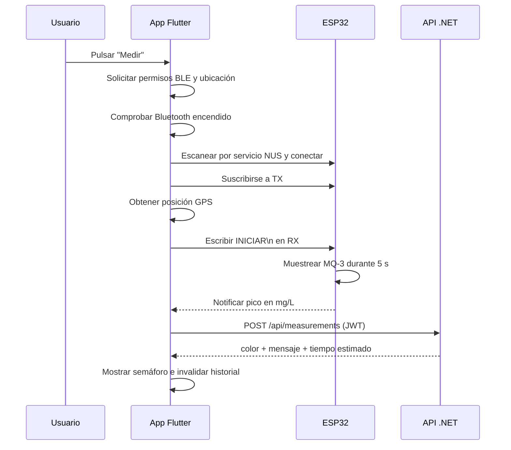

# 📱 Alcoholímetro IoT — App Flutter

[README raíz](../README.md) · [API REST](../API/README.md) · [Runbook](../RUNBOOK.md)

Aplicación Flutter del sistema. En **Android e iOS** se conecta por Bluetooth Low
Energy al ESP32, obtiene la medición del sensor MQ-3, la geolocaliza y la envía a
la API. En **web** permite gestionar la cuenta, los grupos y el historial, pero
no medir por BLE.

> **Proyecto educativo (TFG).** No es un alcoholímetro homologado. Las
> mediciones son orientativas y no sustituyen a un test oficial ni a una
> valoración médica.

---

## Índice

- [Qué hace](#qué-hace)
- [Plataformas](#plataformas)
- [Arquitectura](#arquitectura)
- [Requisitos](#requisitos)
- [Puesta en marcha](#puesta-en-marcha)
- [Firebase y notificaciones](#firebase-y-notificaciones)
- [BLE y flujo de medición](#ble-y-flujo-de-medición)
- [Pantallas y funcionalidades](#pantallas-y-funcionalidades)
- [Builds y despliegue](#builds-y-despliegue)
- [Tests](#tests)
- [Limitaciones conocidas](#limitaciones-conocidas)
- [Documentación relacionada](#documentación-relacionada)

---

## Qué hace

| Área | Funcionalidad |
|---|---|
| **Autenticación** | Registro, login, refresh automático del access token, perfil y logout. |
| **Panel** | Dashboard responsive con accesos a medición, grupos, historial y emergencia (112). |
| **Medición** | Escaneo y conexión BLE, permisos, ubicación GPS, envío a la API y semáforo con tiempo estimado. |
| **Historial** | Mediciones paginadas de 20 en 20, scroll infinito, pull-to-refresh y enlace a Google Maps. |
| **Grupos** | Listado, creación, unión por código, detalles, miembros, ranking, umbral de alerta, ascenso, expulsión y abandono. |
| **Notificaciones** | Registro del token FCM y aviso en primer plano mediante `SnackBar`. |
| **Web** | Gestión de cuenta, grupos e historial; la medición BLE se desactiva. |

---

## Plataformas

| Plataforma | Estado | Notas |
|---|---|---|
| **Android** | Objetivo principal | BLE, GPS y push. Requiere Bluetooth y ubicación activos para escanear. |
| **iOS** | Objetivo principal | BLE, GPS y push. Deployment target 13.0. |
| **Web** | Soportado para gestión | Sin BLE; útil para historial, grupos y perfil. Requiere CORS en la API. |
| **Windows / Linux / macOS** | Carpetas generadas, no soportado | `BleService.isAvailable` solo devuelve `true` en Android/iOS. |

La app **no implementa BLE en web**: el firmware es BLE y la medición es una
función móvil.

---

## Arquitectura

Organización **feature-first**: `core/` contiene infraestructura compartida y
`features/` agrupa cada dominio funcional.

```text
APP/
├── lib/
│   ├── core/
│   │   ├── auth/auth_session.dart          # Evento de cierre de sesión forzado
│   │   ├── network/
│   │   │   ├── api_client.dart             # Dio + URL base
│   │   │   ├── auth_interceptor.dart       # Bearer + refresh + retry
│   │   │   └── error_handler.dart          # Mensajes de error legibles
│   │   ├── notifications/push_service.dart # FCM, VAPID y token
│   │   ├── routing/app_router.dart         # go_router + redirect por auth
│   │   ├── storage/secure_storage_service.dart
│   │   ├── theme/app_theme.dart
│   │   ├── ui/loading_provider.dart
│   │   └── utils/jwt_utils.dart            # Extrae el `sub` del JWT
│   ├── features/
│   │   ├── auth/                           # data / domain / presentation
│   │   ├── ble/                            # BleService + BleController
│   │   ├── groups/                         # listado, detalle, ranking
│   │   ├── home/                           # dashboard y navegación
│   │   └── measurements/                   # medición e historial
│   ├── firebase_options.dart
│   └── main.dart
├── test/
│   ├── core/network/auth_interceptor_test.dart
│   ├── features/home/dashboard_emergency_button_test.dart
│   └── widget_test.dart
├── android/ · ios/ · web/ · ...
└── pubspec.yaml
```

### Capas y responsabilidades

| Pieza | Responsabilidad |
|---|---|
| `main.dart` | Inicializa Firebase (con `try/catch`), monta `ProviderScope`, `MaterialApp.router`, el overlay global de carga y el listener de mensajes FCM en primer plano. |
| `core/routing` | Rutas y redirección: sin sesión → `/login`; con sesión en `/login` o `/register` → `/home`. |
| `core/network` | Dio con timeouts de 15 s, `AuthInterceptor` y traducción de errores HTTP a mensajes en español. |
| `core/storage` | Tokens y `userId` en `flutter_secure_storage` (`access_token`, `refresh_token`, `user_id`). |
| `features/auth` | Repositorio, controlador de sesión, perfil y pantallas de login/registro. |
| `features/ble` | Servicio BLE (NUS) y controlador de estado (escaneo, conexión, medición). |
| `features/measurements` | Repositorio de mediciones, pantalla de medición e historial paginado. |
| `features/groups` | Repositorio, controladores y pantallas de grupos/ranking. |
| `features/home` | Dashboard responsive y navegación principal. |

### Navegación

| Ruta | Pantalla | Acceso |
|---|---|---|
| `/login` | Login | Pública. |
| `/register` | Registro | Pública. |
| `/home` | Dashboard | Autenticado. |
| `/groups` | Mis grupos | Autenticado. |
| `/groups/:id` | Detalle del grupo | Autenticado y miembro. |
| `/history` | Historial | Autenticado. |
| `/profile` | Perfil | Autenticado. |

La navegación principal usa un `StatefulShellRoute.indexedStack`: barra inferior
en móvil (< 768 px) y rail lateral en escritorio/tablet.

### Estado y red

- **Riverpod** (`flutter_riverpod`) con `StateNotifierProvider` y
  `AsyncNotifierProvider`; `ProviderScope` en la raíz.
- **Dio** con `baseUrl` configurable, `contentType: application/json` y timeouts
  de conexión, envío y recepción de 15 segundos.
- **`AuthInterceptor`**:
  - añade `Authorization: Bearer <accessToken>` a cada petición;
  - ante un `401`, intenta refrescar con `POST /api/users/refresh` usando una
    única petición concurrente (*single-flight*);
  - si el refresh funciona, guarda los tokens nuevos y reintenta la petición;
  - si falla, borra los tokens, emite `authSessionEventProvider` y el
    `AuthController` cierra la sesión;
  - no intenta refrescar en `/api/users/login` ni en `/api/users/refresh`.
- **`error_handler.dart`** extrae `detail`, `title`, `message` o `error` de
  `ProblemDetails` y muestra mensajes en español.

---

## Requisitos

- **Flutter 3.32+ / Dart 3.8+**. El `pubspec.lock` resuelve
  `flutter >=3.29.0` y `dart >=3.8.0-0`; como Dart 3.8 requiere Flutter 3.32,
  el mínimo efectivo es **Flutter 3.32+**. El `pubspec.yaml` declara
  `sdk: >=3.7.0`, pero las dependencias resueltas elevan el requisito.
- **Android Studio** con un emulador o dispositivo Android (para BLE real se
  necesita un dispositivo físico).
- **Xcode** en macOS para compilar iOS.
- **Chrome** para la versión web.
- **API en marcha** (local o Cloud Run).
- **Firebase** solo si quieres notificaciones push.
- **Modo desarrollador de Windows** si ejecutas Flutter en Windows:

  ```powershell
  start ms-settings:developers
  ```

---

## Puesta en marcha

### 1. Dependencias

```bash
cd APP
flutter pub get
```

### 2. Configurar la URL de la API

La URL se resuelve en este orden:

1. `--dart-define=API_BASE_URL=...` al ejecutar o compilar.
2. Valor por defecto de `lib/core/network/api_client.dart`:
   `https://alcoholimetro-api-282349243482.europe-southwest1.run.app`.

| Entorno | URL recomendada |
|---|---|
| Cloud Run (por defecto) | `https://alcoholimetro-api-282349243482.europe-southwest1.run.app` |
| Emulador Android | `http://10.0.2.2:5231` |
| iOS Simulator / web local | `http://127.0.0.1:5231` |
| Dispositivo físico | `http://IP_DE_TU_PC:5231` o la URL HTTPS de ngrok |
| API desplegada | La URL que devuelva Cloud Run |

Ejemplos:

```bash
# Emulador Android contra la API local
flutter run -d android --dart-define=API_BASE_URL=http://10.0.2.2:5231

# iOS Simulator o Chrome contra la API local
flutter run -d chrome --dart-define=API_BASE_URL=http://127.0.0.1:5231

# Móvil físico a través de ngrok
flutter run --dart-define=API_BASE_URL=https://abcd.ngrok-free.app
```

> **Web y CORS:** para usar Flutter Web, el origen de la app debe estar en
> `Cors:AllowedOrigins` de la API. En Development, una lista vacía activa el
> fallback permisivo; `"*"` no es un comodín para `WithOrigins`. Revisa la
> sección CORS de [API/README.md](../API/README.md#cors).

### 3. Ejecutar

```bash
flutter run -d chrome
flutter run -d android
flutter run -d ios
```

Si no pasas `API_BASE_URL`, la app apunta al servicio de Cloud Run. Para
desarrollo local, indica siempre la URL.

### 4. Tests

```bash
flutter test
```

---

## Firebase y notificaciones

Firebase es **opcional para arrancar**: `main.dart` captura el fallo de
`Firebase.initializeApp` y la app sigue funcionando sin push. Para habilitarlas:

### Configuración del cliente

```bash
flutterfire configure
```

Esto genera/actualiza `lib/firebase_options.dart`. También puedes colocar:

- `android/app/google-services.json`.
- `ios/Runner/GoogleService-Info.plist`.

Ambos archivos están ignorados por Git.

### Web

La app web usa FCM con la clave VAPID declarada en
`lib/core/notifications/push_service.dart` y registra
`web/firebase-messaging-sw.js` desde `web/index.html`.

> **Importante:** `web/firebase-messaging-sw.js` y los valores web de
> `firebase_options.dart` vienen con placeholders `TODO_FIREBASE_WEB_API_KEY` y
> `TODO_FIREBASE_WEB_APP_ID`. Sustitúyelos por la configuración real de la app
> web de Firebase o vuelve a ejecutar `flutterfire configure`. El service worker
> puede requerir actualización manual.

### Proyecto de Firebase

El backend usa por defecto el proyecto `alcoholimetro-1f6ab`
(`Firebase:ProjectId` en `appsettings.json`). Revisa que
`lib/firebase_options.dart` y `web/firebase-messaging-sw.js` apunten al mismo
proyecto; si no, las push no llegarán. Regenerar la configuración con
`flutterfire configure` es la forma más segura de alinearlos.

### Registro del token

Cuando hay sesión iniciada, `PushService`:

1. solicita permiso de notificaciones en Android/iOS;
2. obtiene el token FCM (con VAPID en web);
3. lo registra con `PUT /api/users/device-token`;
4. escucha `onTokenRefresh` y vuelve a registrarlo;
5. expone los mensajes en primer plano; `main.dart` los muestra como `SnackBar`.

Si el registro falla, se escribe un `debugPrint` y la app continúa.

---

## BLE y flujo de medición

### Servicio NUS

El firmware se anuncia como `Alcoholimetro` y expone el **Nordic UART Service
(NUS)**:

| Característica | UUID | Uso |
|---|---|---|
| Servicio NUS | `6E400001-B5A3-F393-E0A9-E50E24DCCA9E` | Servicio BLE principal. |
| RX | `6E400002-B5A3-F393-E0A9-E50E24DCCA9E` | La app escribe `INICIAR\n`. |
| TX | `6E400003-B5A3-F393-E0A9-E50E24DCCA9E` | El ESP32 notifica `READY` y el resultado en mg/L. |

### Flujo



### Implementación

- `BleService.isAvailable` solo es `true` en Android/iOS; en web las operaciones
  no están disponibles.
- El escaneo filtra por el UUID del servicio NUS, tiene un timeout de 8 s y
  detiene cualquier escaneo anterior antes de empezar (evita estados stale tras
  una desconexión).
- La conexión descubre servicios, localiza RX/TX, activa notificaciones en TX y
  se suscribe al stream.
- `READY` se ignora; el resto de notificaciones se parsean como `double` (mg/L).
- `startMeasurement()` escribe `INICIAR\n` en RX.
- La pantalla de medición espera la lectura con un timeout de **15 s** y luego
  hace el `POST` a la API.
- Si el Bluetooth se apaga o el dispositivo se desconecta, `BleController`
  actualiza el estado y la UI vuelve a permitir conectar.

### Permisos

| Plataforma | Permisos |
|---|---|
| **Android** | `BLUETOOTH_SCAN`, `BLUETOOTH_CONNECT`, `ACCESS_FINE_LOCATION`, `ACCESS_COARSE_LOCATION`, `POST_NOTIFICATIONS` (Android 13+). Para escanear, Bluetooth y ubicación deben estar activos. |
| **iOS** | `NSBluetoothAlwaysUsageDescription`, `NSBluetoothPeripheralUsageDescription`, `NSLocationWhenInUseUsageDescription`, `UIBackgroundModes` con `bluetooth-central`, `fetch` y `remote-notification`. |

La app solicita `bluetoothScan`, `bluetoothConnect` y `locationWhenInUse` antes
de escanear. Si el usuario deniega ubicación, no se puede registrar la medición.

---

## Pantallas y funcionalidades

### Login y registro

- Login con email y contraseña; guarda tokens y extrae el `userId` del JWT.
- Registro con nombre, apellidos, email, contraseña, fecha de nacimiento, peso,
  altura, sexo biológico y fecha de licencia (opcional).
- Redirección automática según el estado de autenticación.
- Errores de la API mostrados en español.

### Dashboard

- Layout responsive: barra inferior en móvil, rail lateral en pantallas anchas.
- Tarjetas de acceso rápido: **Medir**, **Grupos**, **Historial** y
  **Emergencia**.
- En web, la tarjeta de medición muestra "Solo en móvil" y no abre la pantalla
  BLE.
- **Emergencia**: diálogo de confirmación y llamada al **112** con
  `url_launcher`; en web solo muestra el aviso.

### Medición

- Selector de dispositivo BLE con escaneo y conexión.
- Estado de conexión, botón de medición y mensajes de error.
- Solicita ubicación de alta precisión antes de medir.
- Muestra el semáforo (verde/amarillo/rojo), el mensaje de la API y el tiempo
  estimado hasta verde.
- Invalida el historial después de registrar una medición.

### Historial

- Carga páginas de 20 mediciones con scroll infinito.
- Pull-to-refresh y reintento en caso de error.
- Cada tarjeta muestra nivel, fecha/hora y un enlace a Google Maps si hay
  coordenadas.
- El color de la tarjeta se calcula en cliente con los mismos umbrales
  orientativos (0,25 / 0,50 mg/L).

### Grupos

- Listado de grupos con rol (`Admin`/`Member`).
- Crear grupo y unirse con código de invitación.
- Detalle con pestañas de **Miembros** y **Ranking**.
- Copiar el código de invitación.
- Editar el umbral de alerta (solo admin).
- Ascender a admin, expulsar miembros y abandonar el grupo.
- El ranking muestra la medición más alta de cada miembro y resalta las que
  superan el umbral.

### Perfil

- Carga el perfil desde `GET /api/users/{id}`.
- Edita peso, altura y licencia (`hasLicense`).
- Muestra edad, sexo, condición de conductor novel y estado de licencia.
- Logout local (borra tokens y vuelve a `/login`).

---

## Builds y despliegue

### Android APK

```bash
cd APP
flutter build apk --release --dart-define=API_BASE_URL=https://tu-api.example.com
```

Salida: `APP/build/app/outputs/flutter-apk/app-release.apk`.

> **Firma:** `android/app/build.gradle.kts` usa la clave de debug para release
> (`signingConfig = signingConfigs.getByName("debug")`). Es válido para probar,
> pero **no para publicar** en Google Play. Configura un keystore de release
> antes de distribuir.

### Web y Firebase Hosting

```bash
cd APP
flutter build web --release --dart-define=API_BASE_URL=https://tu-api.example.com
```

Salida: `APP/build/web`.

Para Firebase Hosting:

```bash
firebase deploy --only hosting
```

El repositorio **no incluye `firebase.json`**. Inicializa Hosting con
`firebase init hosting` (directorio público: `build/web`) antes del primer
despliegue. Añade el dominio de Hosting a `Cors:AllowedOrigins` de la API.

### iOS

```bash
cd APP
flutter build ios --release --dart-define=API_BASE_URL=https://tu-api.example.com
```

Requiere macOS, Xcode y firma configurada. Para una compilación sin firma:
`flutter build ios --release --no-codesign`.

---

## Tests

```bash
cd APP
flutter test
```

| Archivo | Qué cubre |
|---|---|
| `test/core/network/auth_interceptor_test.dart` | Añade el header Bearer, no lo añade sin token, refresh ante 401, limpieza y logout cuando falla el refresh, y evita bucles en `/api/users/refresh`. |
| `test/features/home/dashboard_emergency_button_test.dart` | Render de la tarjeta de emergencia, diálogo de confirmación y cancelación. |
| `test/widget_test.dart` | Arranque de la app y render de la pantalla de login. |

No hay tests de BLE real, de cámara/hardware ni E2E contra la API. El flujo BLE
se prueba manualmente con el ESP32.

---

## Limitaciones conocidas

- **BLE solo en Android/iOS.** La web no puede medir; solo gestiona cuenta,
  grupos e historial.
- **Sin modo offline.** Si no hay red, la medición no se persiste; no hay cola de
  sincronización.
- **Sin BLE en segundo plano.** La app debe estar abierta y en primer plano para
  escanear, conectar y medir.
- **Firebase opcional y web con placeholders.** Sin configuración real, no hay
  push. En web hay que sustituir los `TODO_FIREBASE_WEB_*` del service worker y
  de `firebase_options.dart`.
- **Proyecto de Firebase a revisar.** El backend usa `alcoholimetro-1f6ab`; las
  opciones web/iOS del repo pueden apuntar a otro ID. Regenera con
  `flutterfire configure`.
- **Firma de release con debug.** El APK de release actual no está listo para
  tiendas.
- **Sin recuperación de contraseña ni verificación de email.** Depende de
  mejoras en la API.
- **Sin localización.** Los textos están en español y codificados en la UI.
- **Sin auditoría de accesibilidad ni tests E2E.**
- **Carpetas de escritorio sin soporte real.** Windows/Linux/macOS se generaron
  con Flutter, pero el flujo BLE no está probado ahí.

---

## Documentación relacionada

| Documento | Contenido |
|---|---|
| [README raíz](../README.md) | Visión general del TFG, arquitectura, hardware, puesta en marcha y limitaciones. |
| [API/README.md](../API/README.md) | Endpoints, autenticación, configuración, FCM, migraciones y despliegue del backend. |
| [RUNBOOK.md](../RUNBOOK.md) | Guía operativa: API local, ngrok, CORS, Firebase, firmware, BLE y despliegue. |
| [arduinocode.txt](../arduinocode.txt) | Firmware ESP32 con MQ-3, OLED y BLE NUS. |
| [pubspec.yaml](pubspec.yaml) | Dependencias y versiones de Flutter/Dart. |
