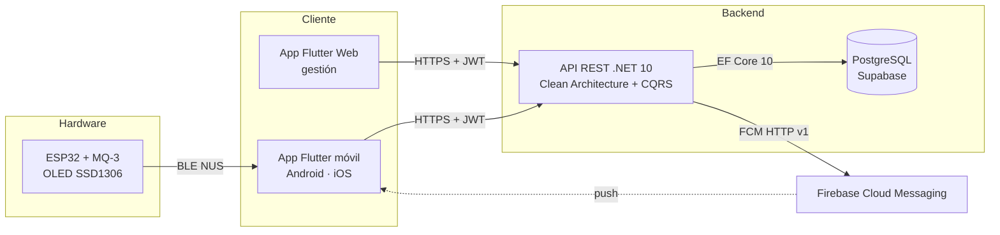
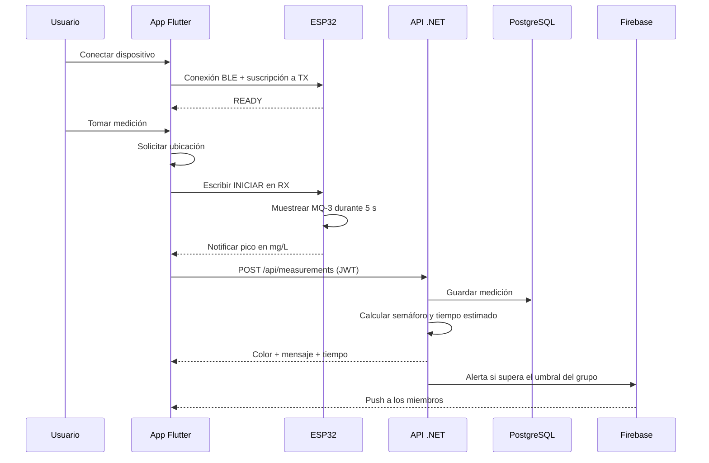

# Alcoholímetro IoT (Alcoholometer)

**Sistema IoT de medición orientativa de alcohol en aire espirado: sensor MQ-3 + ESP32, app Flutter, API REST en .NET y alertas push para grupos.**

[](https://dotnet.microsoft.com/)
[](https://flutter.dev/)
[](https://supabase.com/)
[](https://www.espressif.com/)
[](https://firebase.google.com/)
[](https://cloud.google.com/run)
[](#contexto-educativo)

> **Proyecto educativo (TFG).** Desarrollado como Trabajo de Fin de Grado y
> publicado como muestra de aprendizaje. No es un producto comercial ni un
> alcoholímetro homologado: las mediciones son orientativas y no sustituyen a un
> test oficial, a una valoración médica ni al criterio de las autoridades.

---

## Índice

- [Contexto educativo](#contexto-educativo)
- [Qué hace](#qué-hace)
- [Arquitectura](#arquitectura)
- [Componentes](#componentes)
  - [API](#api-api)
  - [App Flutter](#app-flutter-app)
  - [Firmware ESP32](#firmware-esp32-arduinocodetxt)
- [Tecnologías](#tecnologías)
- [Estructura del repositorio](#estructura-del-repositorio)
- [Puesta en marcha](#puesta-en-marcha)
- [Cómo probarlo](#cómo-probarlo)
- [Seguridad y autenticación](#seguridad-y-autenticación)
- [Grupos, ranking y notificaciones](#grupos-ranking-y-notificaciones)
- [Despliegue](#despliegue)
- [Limitaciones y siguientes pasos](#limitaciones-y-siguientes-pasos)
- [Qué he aprendido](#qué-he-aprendido)
- [Documentación](#documentación)
- [Autoría](#autoría)

---

## Contexto educativo

Este TFG nació con el objetivo de construir un sistema **completo y funcional**
alrededor de un alcoholímetro casero, no solo una de sus partes. El proyecto
integra en un mismo flujo:

- **Hardware**: sensor MQ-3, ESP32 y pantalla OLED.
- **Comunicación inalámbrica**: Bluetooth Low Energy mediante el servicio NUS.
- **Aplicación móvil**: Flutter para Android e iOS, con versión web de gestión.
- **Backend**: API REST en .NET con autenticación, mediciones y grupos.
- **Persistencia**: PostgreSQL alojado en Supabase.
- **Notificaciones**: Firebase Cloud Messaging (FCM).
- **Despliegue**: Docker, Google Cloud Run y Firebase Hosting.

El repositorio se publica como portfolio educativo. Se han separado las
responsabilidades en tres piezas —firmware, app y API— y se documentan también
sus limitaciones, especialmente las del sensor y del modelo de cálculo.

> **Aviso importante:** este sistema no es un alcoholímetro legal ni médico. El
> MQ-3 es un sensor de gas de bajo coste, no selectivo y sensible a la
> temperatura, la humedad y otros compuestos. Los resultados deben tratarse como
> una aproximación.

---

## Qué hace

| Área | Funcionalidad |
|---|---|
| **Medición** | El ESP32 muestrea el MQ-3 durante 5 segundos y devuelve el pico máximo en mg/L. |
| **Conectividad** | La app se conecta por BLE (Nordic UART Service), envía `INICIAR` y recibe el resultado. |
| **Geolocalización** | Cada medición se asocia a la posición del usuario en el momento del test. |
| **Semáforo** | La API calcula verde, amarillo o rojo según los límites legales de referencia y el perfil del conductor. |
| **Estimación** | En amarillo/rojo se estima el tiempo hasta volver a la tasa legal con un modelo lineal simplificado. |
| **Historial** | La app muestra las mediciones del usuario con paginación y código de colores. |
| **Grupos** | Crear grupos, unirse con código de invitación, roles de admin/miembro, ranking y umbral de alerta. |
| **Alertas** | Si una medición supera el umbral del grupo, se envía una push a los demás miembros y al propio usuario. |
| **Autenticación** | Registro, login, JWT de acceso, refresh tokens y cierre de sesión. |
| **Multiplataforma** | Android/iOS para medir por BLE; web para consultar historial, grupos y perfil. |
| **Emergencia** | Acceso rápido al 112 desde el panel principal en móvil. |

---

## Arquitectura



El ESP32 **no se conecta a Internet**: actúa como periférico BLE y es la app
móvil la que hace de puente hacia la API. La versión web no implementa la
medición BLE (la app desactiva esa función fuera de Android/iOS); sí puede
gestionar la cuenta, los grupos y el historial.

### Flujo de una medición



---

## Componentes

### API (`API/`)

API REST central del sistema. Sigue **Clean Architecture** con **CQRS** y
**Domain-Driven Design**, dividida en cuatro capas:

| Capa | Responsabilidad |
|---|---|
| `Alcoholimetro.Api` | Controladores, inyección de dependencias, middleware, Swagger/OpenAPI. |
| `Alcoholimetro.Application` | Commands, queries, handlers, DTOs y servicios de aplicación. |
| `Alcoholimetro.Infrastructure` | EF Core, repositorios, migraciones, JWT y FCM. |
| `Alcoholimetro.Domain` | Entidades, value objects, enums, excepciones y cálculo de alcoholemia. |

Incluye autenticación JWT con refresh tokens, gestión de usuarios, mediciones
con geolocalización, grupos colaborativos, ranking, configuración de umbrales y
notificaciones push. La documentación detallada —endpoints principales, modelos,
seguridad y setup— está en **[API/README.md](API/README.md)**.

### App Flutter (`APP/`)

Aplicación Flutter 3.7+ organizada por funcionalidades:

- **Auth**: login, registro, perfil y cierre de sesión.
- **Home**: panel de control responsive con accesos rápidos y botón de emergencia.
- **BLE**: escaneo, conexión, permisos y flujo de medición.
- **Measurements**: pantalla de medición, semáforo e historial paginado.
- **Groups**: listado, creación, unión por código, detalles, miembros, ranking y configuración.
- **Core**: routing con `go_router`, red con Dio, almacenamiento seguro, tema y notificaciones.

La app usa **Riverpod** para el estado, **flutter_secure_storage** para los
tokens y un interceptor de Dio que renueva el access token automáticamente. La
configuración de la URL de la API y los detalles de ejecución están en
**[APP/README.md](APP/README.md)**.

### Firmware ESP32 (`arduinocode.txt`)

Sketch de Arduino para ESP32 con sensor **MQ-3** y pantalla **OLED SSD1306** por
I2C. El dispositivo se anuncia como `Alcoholimetro` y expone el **Nordic UART
Service (NUS)**:

| Característica | UUID | Uso |
|---|---|---|
| Servicio NUS | `6E400001-B5A3-F393-E0A9-E50E24DCCA9E` | Servicio BLE principal. |
| RX | `6E400002-B5A3-F393-E0A9-E50E24DCCA9E` | La app escribe `INICIAR`. |
| TX | `6E400003-B5A3-F393-E0A9-E50E24DCCA9E` | El ESP32 notifica `READY` y el resultado. |

El test dura **5 segundos** (50 muestras cada 100 ms). El firmware calcula la
resistencia del sensor, estima los mg/L y se queda con el pico máximo. Después
muestra el resultado en la OLED y lo envía por BLE. No usa Wi-Fi ni se conecta
directamente a la API.

> **Calibración:** el valor `R0 = 10.0 kΩ` del sketch es un punto de partida, no
> una calibración real. El MQ-3 necesita un periodo de calentamiento y un ajuste
> con referencias conocidas. Sin esa calibración, los valores son orientativos.

---

## Tecnologías

| Capa | Tecnología |
|---|---|
| Backend | .NET 10, ASP.NET Core, Clean Architecture, CQRS, DDD |
| Persistencia | Entity Framework Core 10, Npgsql, PostgreSQL (Supabase) |
| Autenticación | JWT Bearer (HMAC-SHA256), refresh tokens, BCrypt |
| Notificaciones | Firebase Cloud Messaging HTTP v1 |
| Documentación API | OpenAPI + Swagger UI |
| App | Flutter 3.7+, Dart 3.7+, Riverpod, go_router, Dio |
| App: almacenamiento | flutter_secure_storage |
| App: BLE y sensores | flutter_blue_plus, geolocator, permission_handler |
| App: push | firebase_core, firebase_messaging |
| Firmware | ESP32, Arduino, BLE NUS, MQ-3, SSD1306, U8g2 |
| Infraestructura | Docker, Google Cloud Run, Firebase Hosting, Supabase |
| Tests | xUnit, Moq, FluentAssertions, flutter_test |

---

## Estructura del repositorio

```text
Alcoholometer/
├── API/
│   ├── Alcoholimetro.Api/              # Controladores, middleware, Program.cs
│   ├── Alcoholimetro.Application/      # Commands, queries, handlers, DTOs
│   ├── Alcoholimetro.Domain/           # Entidades, value objects, cálculo
│   ├── Alcoholimetro.Infrastructure/   # EF Core, repositorios, JWT, FCM, migraciones
│   ├── Alcoholimetro.Application.Tests/
│   ├── Alcoholimetro.Api.IntegrationTests/
│   ├── actualizacion.sql               # Scripts idempotentes para Supabase
│   ├── grupos.sql
│   ├── refresh.sql
│   ├── Dockerfile
│   ├── Alcoholimetro.slnx
│   └── README.md                       # Documentación detallada del backend
├── APP/
│   ├── lib/
│   │   ├── core/                       # Routing, red, storage, tema, push
│   │   └── features/                   # auth, home, ble, measurements, groups
│   ├── android/ ios/ web/ ...
│   ├── test/
│   ├── pubspec.yaml
│   └── README.md                       # Configuración de la app
├── arduinocode.txt                     # Firmware ESP32
├── RUNBOOK.md                          # Guía operativa local y de despliegue
└── README.md
```

---

## Puesta en marcha

### Requisitos

- **.NET 10 SDK**.
- **Flutter 3.7+** (Dart 3.7+) y un emulador o dispositivo.
- **PostgreSQL** local o un proyecto de **Supabase**.
- **Arduino IDE 2.x** con soporte para ESP32 (solo si vas a montar el hardware).
- **ngrok** (opcional, para exponer la API local a un móvil físico).
- **Modo desarrollador de Windows** activado si vas a ejecutar Flutter en Windows:

  ```powershell
  start ms-settings:developers
  ```

### 1. API

```bash
git clone https://github.com/carguegar/Alcoholometer.git
cd Alcoholometer
dotnet restore API/Alcoholimetro.slnx
```

Configura los secretos locales con **User Secrets** (no los escribas en el
repositorio):

```bash
dotnet user-secrets set "ConnectionStrings:DefaultConnection" "Host=localhost;Port=5432;Database=alcoholimetro;Username=postgres;Password=TU_PASSWORD" --project API/Alcoholimetro.Api
dotnet user-secrets set "Jwt:Secret" "TU_CLAVE_DE_AL_MENOS_32_CARACTERES" --project API/Alcoholimetro.Api
```

Arranca la API:

```bash
dotnet run --project API/Alcoholimetro.Api/Alcoholimetro.Api.csproj
```

| Recurso | URL |
|---|---|
| API HTTP | `http://localhost:5231` |
| API HTTPS | `https://localhost:7287` |
| Swagger UI | `http://localhost:5231/swagger` (solo en Development) |

> Si usas Supabase, revisa las notas del **Transaction Pooler** (puerto 6543) en
> [API/README.md](API/README.md). Para aplicar cambios de esquema, el flujo
> recomendado es generar un script idempotente con `dotnet ef migrations script`
> y ejecutarlo en el SQL Editor de Supabase.

### 2. App Flutter

```bash
cd APP
flutter pub get
flutter run --dart-define=API_BASE_URL=http://10.0.2.2:5231
```

La URL depende del entorno:

| Entorno | URL de la API |
|---|---|
| Emulador Android | `http://10.0.2.2:5231` |
| iOS Simulator / web local | `http://127.0.0.1:5231` |
| Dispositivo físico | `http://IP_DE_TU_PC:5231` o la URL HTTPS de ngrok |
| Cloud Run (por defecto) | `https://alcoholimetro-api-282349243482.europe-southwest1.run.app` |

Si no se pasa `--dart-define`, la app usa la URL de Cloud Run definida en
`APP/lib/core/network/api_client.dart`. Para desarrollo local, indica siempre
`API_BASE_URL`.

Firebase es opcional para arrancar la app: si falta la configuración, el fallo de
inicialización se captura y la app sigue funcionando sin push. Para habilitar las
notificaciones:

```bash
flutterfire configure
```

También puedes colocar `google-services.json` en `APP/android/app/` y
`GoogleService-Info.plist` en `APP/ios/Runner/`. Ambos archivos están ignorados
por Git.

### 3. Firmware

1. Copia el contenido de `arduinocode.txt` a un sketch de Arduino IDE, por
   ejemplo `Alcoholimetro/Alcoholimetro.ino`.
2. Instala la librería **U8g2** y el soporte de placas ESP32.
3. Conecta el MQ-3: salida analógica a **GPIO 36**; la OLED SSD1306 por I2C.
4. Calibra `R0` con referencias conocidas y deja calentar el sensor.
5. Carga el sketch y abre el monitor serie a 115200 baudios.

El dispositivo se anuncia como `Alcoholimetro`. En Android deben estar activos
**Bluetooth** y **ubicación** para escanear; la app solicita los permisos de
Bluetooth y geolocalización.

### 4. Tests

```bash
dotnet test API/Alcoholimetro.slnx
cd APP
flutter test
```

Los tests del backend cubren value objects, handlers, cálculo de alcoholemia y
middleware de excepciones. Los de la app cubren el interceptor de autenticación y
algunos widgets del panel.

---

## Cómo probarlo

1. Arranca la API y abre Swagger para comprobar que responde.
2. Enciende el ESP32, abre la app y conecta el dispositivo por BLE.
3. Registra un usuario, inicia sesión y concede permisos de ubicación y Bluetooth.
4. Toma una medición: la app obtendrá la posición, pedirá el soplido y mostrará
   el semáforo con el resultado.
5. Consulta el historial y el perfil.
6. Crea un grupo, copia el código de invitación y únete desde otra cuenta.
7. Configura un umbral bajo y registra una medición para probar el ranking y la
   alerta push (requiere Firebase configurado).

---

## Seguridad y autenticación

| Aspecto | Implementación |
|---|---|
| Contraseñas | Hash con **BCrypt** (salting + hashing). |
| Access token | JWT firmado con HMAC-SHA256, expiración de **1 hora**. |
| Refresh token | 64 bytes aleatorios en Base64, guardados como hash **SHA-256**, expiración de **60 días** y rotación en cada refresco. |
| Endpoints protegidos | `[Authorize]` salvo registro, login y refresh. |
| Identidad | El `userId` de una medición se extrae del JWT; no se acepta en el body. |
| Historial | Cada usuario solo puede consultar sus propias mediciones. |
| App | Tokens en `flutter_secure_storage`; interceptor que renueva o cierra sesión ante un 401. |
| Secretos | User Secrets en desarrollo y variables de entorno en producción. Nunca se suben credenciales, cuentas de servicio ni `google-services.json`. |
| Red | HTTPS, HSTS en producción, cabeceras `X-Content-Type-Options`, `X-Frame-Options` y `Referrer-Policy`. |
| CORS | Orígenes configurables; en Development, una lista vacía activa un fallback permisivo solo para desarrollo. |

La API no incluye todavía verificación de email, recuperación de contraseña,
rate limiting ni bloqueo por intentos fallidos. Son mejoras pendientes.

---

## Grupos, ranking y notificaciones

- Un usuario puede **crear un grupo** y se convierte en administrador.
- El grupo genera un **código de invitación de 6 caracteres**.
- Los miembros pueden **unirse con el código**, consultar el ranking, ver los
  miembros y abandonar el grupo.
- El administrador puede **ascender a otro miembro**, **expulsar miembros** y
  **cambiar el umbral de alerta**.
- Si el administrador abandona el grupo, el rol se transfiere al miembro más
  antiguo; si no queda nadie, el grupo se elimina.
- El **ranking** muestra la medición más alta de cada miembro, ordenada de mayor
  a menor; la API permite filtrar por rango de fechas.
- Cuando una medición supera el umbral del grupo, la API envía una **push FCM** a
  los demás miembros y al propio usuario, con un enlace a Google Maps.
- En Development se puede usar un servicio mock de notificaciones si se deja
  `Firebase:CredentialsPath` vacío y no se define `GOOGLE_APPLICATION_CREDENTIALS`.
  Si se configura una ruta, se usa FCM real.

---

## Despliegue

### API en Google Cloud Run

El `API/Dockerfile` compila con .NET 10 y publica la API en una imagen ligera.
El contexto de build debe ser `API/`, porque el Dockerfile copia los proyectos
desde esa carpeta:

```bash
gcloud run deploy alcoholimetro-api --source API --region europe-southwest1 --allow-unauthenticated
```

Configura en Cloud Run la cadena de conexión, el secreto JWT, las credenciales de
Firebase y los orígenes CORS permitidos mediante variables de entorno o secretos.

### Web en Firebase Hosting

```bash
cd APP
flutter build web --release
firebase deploy --only hosting
```

El repositorio no incluye `firebase.json`; inicializa el proyecto de Hosting con
`firebase init hosting` (directorio público: `build/web`) antes del primer
despliegue.

### APK de Android

```bash
cd APP
flutter build apk --release
```

El APK se genera en `APP/build/app/outputs/flutter-apk/app-release.apk`.

El procedimiento completo —ngrok, CORS, Firebase, firmware, BLE y despliegue—
está en **[RUNBOOK.md](RUNBOOK.md)**.

---

## Limitaciones y siguientes pasos

Limitaciones conscientes de un TFG:

- **El MQ-3 no es selectivo.** Reacciona a alcohol y a otros gases, y depende de
  la temperatura, la humedad y el envejecimiento del sensor. No es un
  alcoholímetro homologado.
- **Calibración pendiente.** `R0 = 10.0 kΩ` es un valor de partida; haría falta
  calibrar con patrones y compensar las condiciones ambientales.
- **Medición simplificada.** Se toma el pico de 5 segundos; no se mide volumen
  espiratorio ni flujo, y no se controla la calidad del soplado.
- **Límites legales de España.** Los valores 0,25 mg/L (general), 0,15 mg/L
  (novel) y 0,60 mg/L (delictivo) están codificados y no son configurables por
  país.
- **Tiempo estimado lineal.** El cálculo de tiempo hasta verde usa una tasa de
  eliminación simplificada y no modela la absorción, la comida ni el metabolismo
  individual.
- **BLE solo en móvil.** La versión web permite gestionar la cuenta, los grupos y
  el historial, pero no medir.
- **Sin modo offline.** La medición se envía a la API; si no hay red, no se
  persiste. No hay cola de sincronización.
- **Push best-effort.** Requiere Firebase configurado y que el usuario conceda
  permisos; no se garantiza la entrega.
- **Seguridad mejorable.** Faltan verificación de email, recuperación de
  contraseña, rate limiting, bloqueo por intentos y revocación global de tokens.
- **Tests limitados.** Hay tests de dominio, aplicación, middleware y algunos
  widgets, pero no pruebas E2E con hardware BLE real.
- **Firmware básico.** Es un sketch único, sin OTA, sin carcasa y sin gestión de
  versiones de firmware.
- **Sin CI/CD.** El despliegue es manual.

Mejoras posibles:

- Calibrar el sensor con un alcoholímetro de referencia y añadir compensación de
  temperatura/humedad.
- Incorporar un sensor de flujo y una etapa de control del soplado.
- Hacer configurables los límites legales por país o comunidad.
- Mejorar el modelo farmacocinético y mostrar un intervalo de confianza.
- Añadir modo offline con cola de sincronización.
- Añadir CI/CD, tests E2E y un mock de BLE para pruebas.
- Implementar verificación de email, recuperación de contraseña, rate limiting y
  revocación de refresh tokens.
- Migrar el firmware a PlatformIO, añadir OTA y documentar el montaje hardware.
- Incluir capturas y un vídeo de demostración en el README.

---

## Qué he aprendido

- A integrar **hardware, firmware, app móvil, API y base de datos** en un flujo
  completo de IoT.
- A diseñar una API con **Clean Architecture**, CQRS y DDD, separando dominio,
  aplicación, infraestructura y presentación.
- A implementar **autenticación JWT con refresh tokens rotativos**, hash de
  contraseñas y almacenamiento seguro en el cliente.
- A trabajar con **BLE NUS**, streams asíncronos, permisos y reconexión.
- A usar **EF Core + PostgreSQL/Supabase**, migraciones y scripts idempotentes.
- A construir una app Flutter con Riverpod, go_router, Dio y almacenamiento
  seguro.
- A desplegar una API en **Cloud Run** y una app web en **Firebase Hosting**.
- A documentar un proyecto y sus límites, especialmente cuando hay hardware y
  seguridad de por medio.

---

## Documentación

| Documento | Contenido |
|---|---|
| [API/README.md](API/README.md) | Arquitectura del backend, stack, seguridad, setup, migraciones, endpoints principales, modelos y flujo de autenticación. |
| [APP/README.md](APP/README.md) | Configuración de la URL de la API y ejecución de la app Flutter. |
| [RUNBOOK.md](RUNBOOK.md) | Guía operativa: API local, ngrok, CORS, Firebase, firmware, BLE y despliegue. |
| [arduinocode.txt](arduinocode.txt) | Sketch completo del firmware ESP32. |
| [API/Alcoholimetro.slnx](API/Alcoholimetro.slnx) | Solución .NET con los proyectos y tests. |

---

## Autoría

Proyecto realizado por **Carlos Guerrero** ([@carguegar](https://github.com/carguegar))
como Trabajo de Fin de Grado (TFG).

Si reutilizas el código, atribuye al autor y ten en cuenta que se comparte con
fines educativos. No utilices este sistema como sustituto de un alcoholímetro
homologado ni para tomar decisiones legales o médicas.
